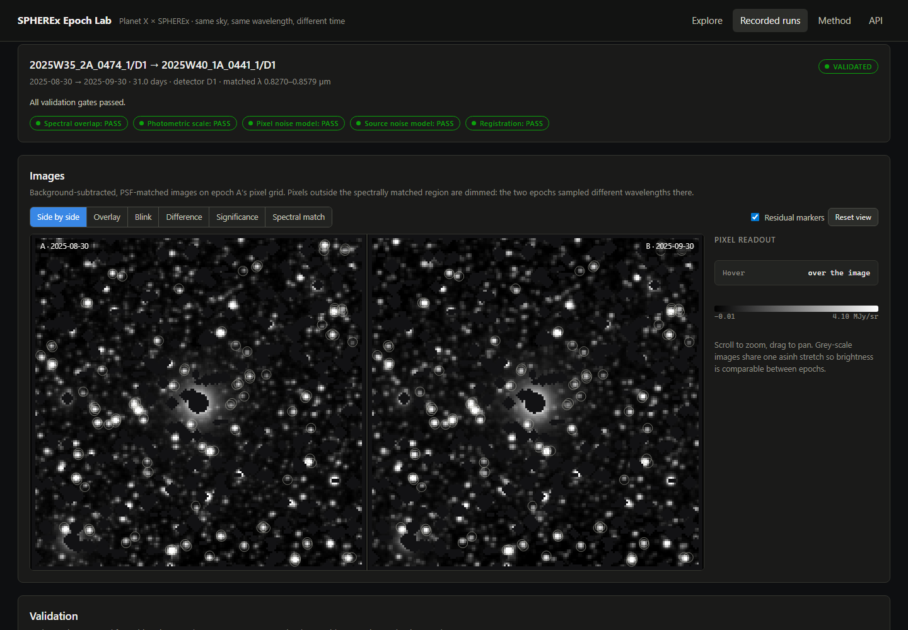

# SPHEREx Epoch Lab: Planet X × SPHEREx

**Same sky, same wavelength, different time.** A web application that finds, compares and validates real NASA SPHEREx observations of the same sky taken at the same wavelength on different dates.



## The problem

SPHEREx maps the whole sky in 102 colours (0.75–5.0 µm) with linear variable filters, so the wavelength a pixel sees depends on where a star lands on the detector. Two SPHEREx images of the same star are usually **different-colour** measurements. A naive difference image turns a star's colour into fake "variability". The archive search only reports a detector-wide wavelength range, which cannot tell you whether two visits are comparable.

## What the Epoch Lab does

1. **Screens every archive record.** For a preset target, a resolved name or RA/Dec, it maps each SPHEREx DR1 record's footprint onto the detector (median error 3.1 px against 26 real cutouts) and reads the detector's DataLink wavelength map. The result is the wavelength SPHEREx actually sampled at the target in each visit. This needs no image downloads and takes about 20 s per target.
2. **Finds same-wavelength epochs.** Same detector, different dates, |Δλ| ≤ 10% of the bandwidth, ranked by the predicted fraction of the field that matches.
3. **Compares real images.** Downloads the cutouts and each observation's own calibration, subtracts backgrounds, cross-convolves the measured PSFs, registers, and differences **only the pixels whose wavelengths match**.
4. **Validates every result** against the pair's own data: registration from catalog stars, photometric scale, a blank-sky null test, an empirical source noise model, and injection–recovery.
5. **Classifies residuals conservatively.** Known proper motion, PSF/registration dipoles, the systematic floor and persistent sources are explained first. Only what remains is a candidate, and candidates must pass vetting.
6. **Builds time series** for three or more same-wavelength epochs: a light curve with field-star zero points, and an astrometric trajectory compared with the catalog proper motion and parallax (JPL Horizons positions of SPHEREx).

## Real results (recorded in `artifacts/epoch_lab/demos/`, regenerate with `python make_demos.py`)

| Run | Data | Result |
|---|---|---|
| **Barnard's Star field**, 31 days apart, 0.83–0.86 µm | `2025W35_2A_0474_1/D1` vs `2025W40_1A_0441_1/D1` | **VALIDATED**, all 5 gates pass. 23,265 matched pixels; registration 0.036″/0.030″ (631 Gaia stars); scale B/A = 1.0033 ± 0.0037; null-test σ = 1.37; noise model calibrated on 909 stars (z-scatter 1.00); 27/31 injected S/N-10 sources recovered. Of 909 stars, 5 exceeded 5σ and all 5 failed vetting (blends or edges); every residual is explained. **No change detected.** The star itself is saturated (flag bits 0, 1, 2, 26). |
| **ε Indi B**, five epochs over a year at 1.107 µm | `2025W17…2026W17`, D2 | Proper motion measured from SPHEREx images: (4.46 ± 0.45, −2.33 ± 0.43) ″/yr, an 11σ detection, 1.1σ from SIMBAD (3.98, −2.47). Light curve consistent with constant flux (14.49 mJy, p = 0.48, 3 usable epochs). Parallax 0.61 ± 0.16″ vs 0.27″: **not reliably constrained** (Birge ratio 3.4). |
| **ε Indi B**, same pointing one year apart at 2.03 µm | `2025W18_1B_0238_1/D3` vs `2026W18_1A_0457_2/D3` | PARTIAL: 19,574 matched pixels over 364 days. The brown dwarf's 0.75-pixel motion is correctly classified as **known proper motion**; its flux change is +0.9 ± 1.0% (consistent with constant). Gaia was unreachable, so image-detected sources calibrated the gates; the source noise model is UNVERIFIED (only 11 sources). |
| **RW Aurigae field**, six months apart | `2025W36_1A_0606_3/D1` vs `2026W10_1A_0445_3/D1` | Field rotation leaves only 1,483 of 19,710 overlapping pixels at the same wavelength (median \|Δλ\|/band elsewhere 0.70). This shows why whole-image differencing would be wrong. |
| **Screening of all five presets** | RW Aur, Barnard, R Dra, ε Indi B, WISE 0855 | 1,474 records screened; 17 / 70 / 171 / 200 / 83 same-wavelength pairs and 0 / 3 / 18 / 31 / 7 groups with ≥3 epochs. |

A comparison started live from the UI during release testing, on the Barnard's Star field at 3.61 µm, also returned **VALIDATED**.

**No discovery is claimed.** Candidates are residuals that need independent follow-up.

## Run it

```powershell
python -m venv .venv
.\.venv\Scripts\python -m pip install -r requirements.txt
.\.venv\Scripts\python -m uvicorn main:app --host 127.0.0.1 --port 8000
```

Open http://127.0.0.1:8000/:

- **Recorded runs** shows the real results above instantly, offline.
- **Explore** runs live analyses: pick a preset, a name or RA/Dec, click *Find same-wavelength epochs*, then *Compare* a pair or build a *Time series* from a group.
- API docs are at `/docs`. The earlier reference-star repeatability tool is at `/multi-epoch`.

```powershell
.\.venv\Scripts\python -m pytest -q          # 249 tests; real-data tests skip if local archive caches are absent
.\.venv\Scripts\python make_demos.py         # re-run every recorded demonstration from the live archive
```

Live runs need network access to NASA/IRSA. IRSA intermittently returns HTTP 502. Requests are retried a bounded number of times, and a job then fails with a specific error rather than substituting data.

## Documentation

- [Methodology](docs/METHODOLOGY.md): every processing step, gate and policy, and what the lab will not conclude
- [Architecture](docs/ARCHITECTURE.md): modules, request flow, caches, concurrency and failure handling
- [Data sources](docs/DATA_SOURCES.md): IRSA SPHEREx DR1, DataLink, Gaia DR3, JPL Horizons, CDS
- [Submission package](docs/SUBMISSION.md): project summary and demo script
- [Research log](docs/RESEARCH_LOG.md): history and measured results of earlier development phases

## Limitations

A single ePSF zone is used per comparison, and PSF variation is absorbed into the empirical floor. Variances after convolution and resampling are marginal, calibrated by the null test. Flux in Jy uses the WCS pixel solid angle, not the official map. Rotated revisits usually match only in a strip. Bright targets saturate. Gaia and CDS services were unreachable during development, so only fields with stored Gaia DR3 query results (Barnard's Star, RW Aurigae) have catalog associations. Other fields use image-detected calibration sources and leave unmatched residuals unclassified.
