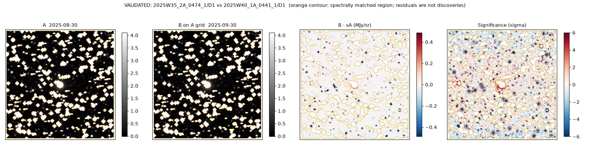
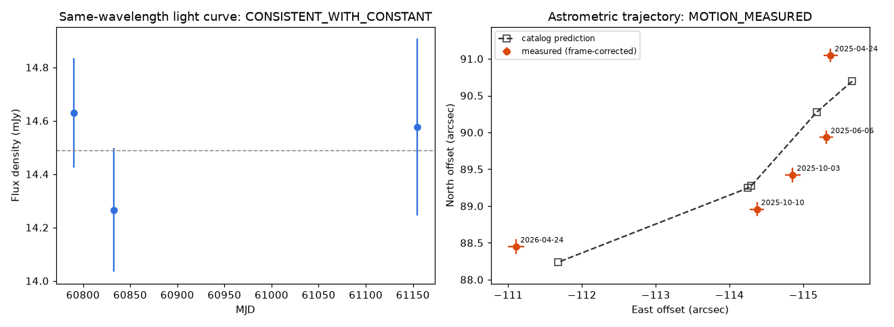

# SPHEREx Epoch Lab: Planet X × SPHEREx

**Same sky, same wavelength, different time.** A web application that finds, compares and validates real NASA SPHEREx observations of the same sky taken at the same wavelength on different dates.



*A real output: Barnard's Star field, 31 days apart at 0.83–0.86 µm. The orange contour marks the pixels whose wavelengths match. All validation gates pass and no change is detected.*

## The problem

SPHEREx maps the whole sky in 102 colours (0.75–5.0 µm) with linear variable filters, so the wavelength a pixel sees depends on where a star lands on the detector. Two SPHEREx images of the same star are usually **different-colour** measurements. A naive difference image turns a star's colour into fake "variability". The archive search only reports a detector-wide wavelength range, which cannot tell you whether two visits are comparable.

## What the Epoch Lab does

1. **Screens every archive record.** For a preset target, a resolved name or RA/Dec, it maps each SPHEREx DR1 record's footprint onto the detector (median error 3.1 px against 26 real cutouts) and reads the detector's DataLink wavelength map. The result is the wavelength SPHEREx actually sampled at the target in each visit. This needs no image downloads and takes about 20 s per target.
2. **Finds same-wavelength epochs.** Same detector, different dates, |Δλ| ≤ 10% of the bandwidth, ranked by the predicted fraction of the field that matches.
3. **Compares real images.** Downloads the cutouts and each observation's own calibration, subtracts backgrounds, cross-convolves the measured PSFs, registers, and differences **only the pixels whose wavelengths match**.
4. **Validates every result** against the pair's own data: registration from catalog stars, photometric scale, a blank-sky null test, an empirical source noise model, and injection–recovery.
5. **Classifies residuals conservatively.** Known proper motion, PSF/registration dipoles, the systematic floor and persistent sources are explained first. Only what remains is a candidate, and candidates must pass vetting.
6. **Builds time series** for three or more same-wavelength epochs: a light curve with field-star zero points, and an astrometric trajectory compared with the catalog proper motion and parallax (JPL Horizons positions of SPHEREx).

If one selected epoch cannot be downloaded or calibrated, a time-series job continues with the remaining observations and marks the report **PARTIAL**. Failed epochs are listed with their reasons; no other epoch's calibration is substituted. At least two usable epochs are required.

## See it

| Way | What you get | Needs |
|---|---|---|
| **Public copy** (GitHub Pages) | Every recorded run below, with images, charts, validation, provenance and downloads. Live analysis is switched off. | A browser. Published by `.github/workflows/pages.yml` once Pages is enabled (see below). |
| **Local server** | The full application: recorded runs plus live screening, comparisons and time series. | Python 3.12 and, for live runs, NASA/IRSA being up. |
| **Static copy on your machine** | The same as the public copy, built locally. | `python build_static_demo.py`, then serve the `site/` folder with any web server, e.g. `python -m http.server -d site`. |

Recorded runs never touch the network, so they work during archive outages.

### Run it locally

```powershell
python -m venv .venv
.\.venv\Scripts\python -m pip install -r requirements.txt
.\.venv\Scripts\python -m uvicorn main:app --host 127.0.0.1 --port 8000
```

Open http://127.0.0.1:8000/:

- **Recorded runs** shows the real results below instantly, offline.
- **Explore** runs live analyses: pick a preset chip, or type a name or RA/Dec into the search bar, click *Find epochs*, then *Compare* a pair or build a *Time series* from a group.
- API docs are at `/docs`. The earlier reference-star repeatability tool is at `/multi-epoch`.

### Publish the public copy

1. Push the repository to GitHub (it must be public, or on a plan that allows Pages for private repositories).
2. In the repository, open **Settings → Pages → Build and deployment** and set **Source** to **GitHub Actions**.
3. The *Public demo* workflow runs on every push to `main`: it re-verifies the recorded results, builds `site/` and publishes it. The address appears in the workflow run and under Settings → Pages.

## How to read a result

Every result page starts with a status badge, then says whether it is a **Recorded run** (made by `make_demos.py`, with the command that reproduces it) or a **Live run** (a job this server just ran, with its job ID and finish time).

| Status | Meaning |
|---|---|
| **VALIDATED** | Every validation gate was tested on this pair's own data and passed. |
| **PARTIAL** | The comparison was computed, but at least one gate was **UNVERIFIED**: the data could not test it (for example too few blank-sky pixels). UNVERIFIED never counts as a pass. |
| **REJECTED** | A gate failed; the difference image is not trustworthy. |

- **Residuals** lists what is left in the difference image and why each residual is explained. Only *Needs follow-up* entries are candidates, and a candidate is not a discovery.
- **Star fluxes** compares every catalog star in matched apertures. *z* is the change divided by its calibrated uncertainty.
- **Provenance and files** lists each observation, the calibration file IRSA DataLink associated with it, the SHA-256 of the science and calibration files, the processing-code hash, the catalog used, and the downloads (FITS, JSON, CSV, PNG).
- In a time series, epochs that could not be measured are listed with the reason, and the light curve uses only points at the same wavelength.

## Real results

Recorded in `artifacts/epoch_lab/demos/`; regenerate with `python make_demos.py`.

| Run | Data | Result |
|---|---|---|
| **Barnard's Star field**, 31 days apart, 0.83–0.86 µm | `2025W35_2A_0474_1/D1` vs `2025W40_1A_0441_1/D1` | **VALIDATED**, all 5 gates pass. 23,265 matched pixels; registration 0.036″/0.030″ (631 Gaia stars); scale B/A = 1.0033 ± 0.0037; null-test σ = 1.37; noise model calibrated on 909 stars (z-scatter 1.00); 27/31 injected S/N-10 sources recovered. Of 909 stars, 5 exceeded 5σ and all 5 failed vetting (blends or edges); every residual is explained. **No change detected.** The star itself is saturated (flag bits 0, 1, 2, 26). |
| **ε Indi B**, five epochs over a year at 1.107 µm | `2025W17…2026W17`, D2 | Proper motion measured from SPHEREx images: (4.46 ± 0.45, −2.33 ± 0.43) ″/yr, an 11σ detection, 1.1σ from SIMBAD (3.98, −2.47). Light curve consistent with constant flux (14.49 mJy, p = 0.48, 3 usable epochs). Parallax 0.61 ± 0.16″ vs 0.27″: **not reliably constrained** (Birge ratio 3.4). |
| **ε Indi B**, same pointing one year apart at 2.03 µm | `2025W18_1B_0238_1/D3` vs `2026W18_1A_0457_2/D3` | PARTIAL: 19,574 matched pixels over 364 days. The brown dwarf's 0.75-pixel motion is correctly classified as **known proper motion**; its flux change is +0.9 ± 1.0% (consistent with constant). Gaia was unreachable, so image-detected sources calibrated the gates; the source noise model is UNVERIFIED (only 11 sources). |
| **RW Aurigae field**, six months apart | `2025W36_1A_0606_3/D1` vs `2026W10_1A_0445_3/D1` | Field rotation leaves only 1,483 of 19,710 overlapping pixels at the same wavelength (median \|Δλ\|/band elsewhere 0.70). This shows why whole-image differencing would be wrong. |
| **Screening of all five presets** | RW Aur, Barnard, R Dra, ε Indi B, WISE 0855 | 1,474 records screened; 17 / 70 / 171 / 200 / 83 same-wavelength pairs and 0 / 3 / 18 / 31 / 7 groups with ≥3 epochs. |



*A real output: ε Indi B over one year at 1.107 µm. Left, the light curve (constant within errors); right, SPHEREx positions against the SIMBAD proper-motion and parallax prediction.*

**No discovery is claimed.** Candidates are residuals that need independent follow-up.

## What has been verified

`python verify_results.py` re-checks every recorded run from its saved products with independent arithmetic and writes [docs/VERIFICATION.md](docs/VERIFICATION.md). Current result: **84 checks, 0 failed, 3 unverified**. The 3 unverified checks are the gates the reports themselves mark UNVERIFIED. Tests prove the checker catches deliberately corrupted results.

| Claim | Evidence | Status |
|---|---|---|
| Only same-wavelength pixels are compared | Every compared pixel has \|Δλ\| ≤ 0.1 × CBAND in the saved FITS plane; every pixel left out either sampled another wavelength or had no valid data | Verified on all 3 comparisons |
| Screened wavelengths are the calibration's | All 1,474 screened records re-read from the DataLink CWAVE maps (SHA-256 checked) at their detector pixel | Verified |
| Uncertainties are calibrated | Blank-sky significance has robust spread 1.000 after the null-test rescaling; star z-scores have spread 0.999 | Verified where the data allow (Barnard, ε Indi B year pair) |
| Significances are computed correctly | Star z, target z, constant-flux χ² and p, proper-motion significance and catalog differences recomputed from the saved values and covariance | Verified |
| **Known mover**: motion is measured correctly | ε Indi B proper motion from SPHEREx alone agrees with the independent SIMBAD value at 1.1σ and is detected at 11.3σ | Verified (one object) |
| **Known variable star**: real brightness changes are detected | Not yet shown on a real star. See below | **Not verified** |
| Results trace to their inputs | Science-file and calibration SHA-256 recomputed; recorded runs were produced by the current processing code (line-ending-independent hash) | Verified |

**Known variable star: not yet verified.** The two variable presets cannot be measured: RW Aurigae's core is flagged as saturated in its recorded run, and R Draconis (a Mira) is far brighter in the infrared than Barnard's Star, which already saturates. Every attempt to run an R Draconis series failed because IRSA DataLink did not return calibrations (HTTP 502). In the Barnard field, the 8 stars Gaia DR3 flags as variable showed no significant change over 31 days (largest |z| = 1.7). That is consistent with small optical variability, but it does not demonstrate sensitivity. The pipeline's sensitivity is so far shown only by injection–recovery (27 of 31 synthetic S/N-10 sources recovered in the real Barnard difference image) and by the synthetic-sky tests. Doing this properly needs an unsaturated, large-amplitude variable with three or more same-wavelength epochs, run while IRSA is available.

## Tests

```powershell
.\.venv\Scripts\python -m pytest -q          # 270 tests; real-data tests skip if local archive caches are absent
.\.venv\Scripts\python verify_results.py     # independent re-check of the recorded runs
.\.venv\Scripts\python make_demos.py         # re-run every recorded demonstration (uses local caches, else the live archive)
.\.venv\Scripts\python build_static_demo.py  # build the public static copy into site/
```

Live runs need network access to NASA/IRSA. IRSA intermittently returns HTTP 502. Requests are retried a bounded number of times, and a job then fails with a specific, plain-language error rather than substituting data. Positions with no SPHEREx coverage, invalid coordinates, unknown names, timeouts, catalog outages and missing calibrations each have their own message.

## Documentation

- [Methodology](docs/METHODOLOGY.md): every processing step, gate and policy, and what the lab will not conclude
- [Verification](docs/VERIFICATION.md): independent re-check of every recorded result (generated)
- [Architecture](docs/ARCHITECTURE.md): modules, request flow, caches, concurrency and failure handling
- [Data sources](docs/DATA_SOURCES.md): IRSA SPHEREx DR1, DataLink, Gaia DR3, JPL Horizons, CDS
- [Submission package](docs/SUBMISSION.md): project summary and demo script
- [Research log](docs/RESEARCH_LOG.md): history and measured results of earlier development phases

## Limitations

- **Calibration and noise.** A single ePSF zone is used per comparison, and PSF variation is absorbed into the empirical floor. Variances after convolution and resampling are marginal, calibrated by the null test. Flux in Jy uses the WCS pixel solid angle, not the official solid-angle map.
- **Geometry.** Rotated revisits usually match only in a strip.
- **Bright targets saturate.** This includes Barnard's Star, RW Aurigae and very likely R Draconis.
- **Catalogs.** Gaia and CDS were unreachable during development, so only fields with stored Gaia DR3 query results (Barnard's Star, RW Aurigae) have catalog associations. Other fields use image-detected calibration sources and leave unmatched residuals unclassified.
- **Verification scope.** Motion is verified on one known mover. Variability detection is not yet verified on a real variable star (see above).
